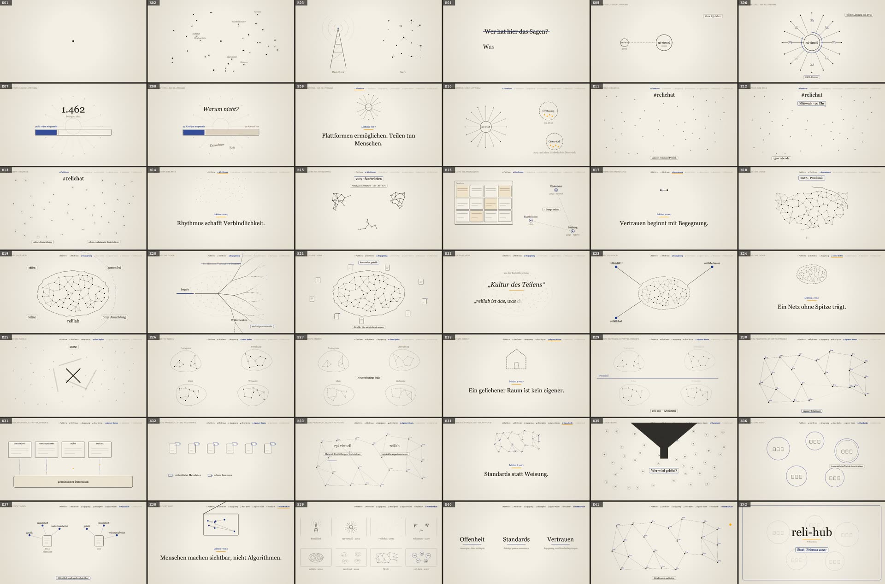

# Making-of: „Vom Sender zum Netz“

Ein neunminütiges Erklärvideo, gebaut aus einem Sprechtext, einer eigenen Stimmaufnahme und
Animationen, die vollständig als Programmcode entstanden sind, ohne Bild- oder Videogenerator.
Der Ordner enthält alles, um das Video nachzubauen oder mit einem eigenen Thema neu zu machen.

- **Video:** <https://vimeo.com/1245397913> (Stream, Download, Einbettung)
- **Anlass:** Impuls im Panel „Zusammenarbeit für bessere Bildung(smaterialien): Was wir von
  Bildungsnetzwerken lernen können“, CollaborAID, 14.11.2026
- **Inhalt:** Wie aus rpi-virtuell, dem #relichat, den relicamps und dem relilab der Entwurf
  eines gemeinsamen Community-Hubs (Arbeitstitel „reli-hub“) entstanden ist, und was das über
  Zusammenarbeit über Institutionsgrenzen hinweg lehrt
- **Lizenz:** Video, Texte, Bilder und Code in diesem Ordner stehen unter
  [CC BY 4.0](https://creativecommons.org/licenses/by/4.0/deed.de).
  Namensnennung: *„Vom Sender zum Netz“, Jörg Lohrer / FOERBICO, Comenius-Institut, CC BY 4.0*



## Was in diesem Ordner liegt

| Pfad | Inhalt |
|---|---|
| [sprechtext.md](sprechtext.md) | Der Text in 42 Sinneinheiten, je mit Bildregie und Quellen |
| [video/](video/) | Die Werkzeugkette: Text zerlegen, Aufnahme ausrichten und schneiden, Szenen, Rendern ([technische Anleitung](video/README.md)) |
| [video/player/szenen.js](video/player/szenen.js) | Die 42 Szenen, jede eine kleine Zeichenfunktion |
| [veroeffentlichung/](veroeffentlichung/) | Untertitel (WebVTT), Kapitelmarken, Vorschaubild, Texte für die Videoplattform |
| [making-of/prompts.md](making-of/prompts.md) | Die Aufträge an den KI-Agenten, zum Wiederverwenden |

Nicht im Repo: die Rohaufnahmen (`video/aufnahme/`) und alles Erzeugte (`video/build/`).

## Wie das Video entstanden ist

Die Arbeit lief an zwei Tagen im Wechsel zwischen Mensch und KI-Agent (Claude Code). Der
Agent hat Textentwürfe, Werkzeuge und Animationen geschrieben; Inhalt, Fakten, Stimme und
alle Entscheidungen lagen beim Autor.

1. **Machart wählen.** Anregung war eine Reihe von Musikvideos, deren Bilder ein Sprachmodell
   als Code zeichnet: Tusche auf Papier, Typografie, Linien. Übernommen wurde die Idee, nicht
   das Format. Statt eines Songs trägt die eigene Stimme das Video, und es wird vorproduziert,
   damit es vor Ort nur noch abgespielt werden muss.
2. **Sprechtext in Sinneinheiten.** Der Agent hat aus vorhandenen Texten im Repo (Literaturbeitrag,
   Interviews, Gesprächsprotokolle, Hub-Dokumentation) einen Entwurf geschrieben. Jede Einheit
   ist ein bis drei Sätze lang und hat eine Zeile Bildregie. Was nicht belegt war, stand als
   `[PRÜFEN: …]` im Text, bis es geklärt war: Gründungsjahre, Termine, Rollen. Die Leitfrage kam
   aus der Einladung zum Panel; sie gibt jeder Station eine „Lektion“.
3. **Überarbeiten.** Mehrere Runden: Fakten ergänzen, Wiederholungen streichen, missverständliche
   Formulierungen ersetzen, auf die Zielzeit kürzen. Ein gedanklicher Rahmen (die Architektur der
   Medien bestimmt, wer etwas zu sagen hat) trägt den Text, ohne zitiert zu werden.
4. **Einsprechen.** In einem Stück mit einem Audiorekorder, nach jedem Absatz kurz Luft holen.
   Bei einem Versprecher wird der ganze Absatz neu gesprochen.
5. **Automatisch schneiden.** Whisper erkennt die Aufnahme mit Zeitstempeln je Wort. Ein Skript
   sucht jede Sinneinheit darin, nimmt bei Wiederholungen die vollständige, letzte Fassung,
   schneidet Versprecher und lange Pausen heraus, setzt gleichmäßige Pausen und normalisiert
   die Lautheit. Ergebnis: eine Tonspur und eine Zeitleiste mit der Zeit jedes Wortes.
6. **Animieren.** Jede Szene ist eine Funktion der Zeit. Bewegungen hängen an gesprochenen
   Wörtern („bei ‚Organigramm‘ wird die Frage durchgestrichen“) und folgen so jeder Aufnahme
   automatisch. Ein Bildmotiv zieht sich durch: die Form des Netzes, vom Sendemast über Stern,
   Puls, Gruppen, Labor und Inseln bis zum Netz über ein Protokoll.
7. **Prüfen, Rückmeldung, zweite Fassung.** Ein Kontaktbogen (ein Standbild je Einheit) und eine
   Gegenprobe (die fertige Tonspur wird noch einmal erkannt und mit dem Text verglichen) fanden
   Fehler, bevor jemand sie hören musste. Nach einer Rückmelderunde im Team kamen hinzu: eine
   mitlaufende Lektionsleiste, ruhigere Animationen, die Projektfarben, ein als Arbeitstitel
   markierter Name und genauere Aussagen zur Lizenzierung. Drei geänderte Absätze wurden
   nachgesprochen und automatisch eingesetzt.
8. **Veröffentlichen.** Aus der Zeitleiste entstehen Untertitel und Kapitelmarken, aus der
   Übersichtsszene das Vorschaubild.

## Nachmachen mit einem eigenen Thema

Voraussetzungen: `python3`, [`uv`](https://docs.astral.sh/uv/), `ffmpeg`, Google Chrome. Alle
Befehle laufen im Ordner `video/`; die [technische Anleitung](video/README.md) erklärt jede Option.

1. **Ordner kopieren** und `sprechtext.md` durch den eigenen Text ersetzen. Das Format:

   ```markdown
   ## Szene 1 · Titel der Szene

   ### E05 · stichwort

   > bild: Was man sieht und was sich bewegt (wird nicht gesprochen).

   Der Sprechtext dieser Sinneinheit. Ein bis drei Sätze.
   ```

   Einheiten mit `· lernsatz` und einem `Lernsatz: „…“` in der Bildregie werden als große
   Merksätze gesetzt. Der Agent kann den Entwurf schreiben; die Aufträge dafür stehen in
   [making-of/prompts.md](making-of/prompts.md).
2. **Lesevorlage erzeugen:** `python3 tools/parse.py` → `build/lesetext.html`.
3. **Aufnehmen** und die Datei nach `video/aufnahme/` legen. Ohne eigene Aufnahme geht es zum
   Ausprobieren mit `python3 tools/testaufnahme.py` (macOS-Sprachausgabe).
4. **Schneiden:** `uv run tools/align.py aufnahme/meine.wav --modell medium`, danach
   `uv run tools/pruefen.py` für die Gegenprobe.
5. **Szenen anpassen** in `video/player/szenen.js`. Einheiten ohne eigene Szene zeigen die
   Bildregie als Platzhalter, so lässt sich sofort mit Ton testen. Vorschau im Browser unter
   `video/player/` (Leertaste spielt ab), Standbilder aller Szenen mit
   `uv run tools/render.py --kontakt`.
6. **Rendern:** `uv run tools/render.py --entwurf` für einen schnellen Entwurf, dann
   `uv run tools/render.py` für 1920×1080 bei 30 Bildern pro Sekunde (etwa 4 Minuten).
7. **Veröffentlichen:** `python3 tools/untertitel.py` (Untertitel und Kapitel) und
   `uv run tools/vorschaubild.py "Titel" "Untertitel"`.

Farben und Schrift stehen in `video/player/zeichnen.js` (`FARBEN`, `SCHRIFT`), die
wiederkehrenden Bildmotive in `video/player/motive.js`.

## Was sich bewährt hat und worauf man achten sollte

- **Zeitleiste aus der Aufnahme, nicht aus Schätzungen.** Weil die Bewegungen an Wörtern hängen,
  passen sie zu jeder Aufnahme und überstehen Nachaufnahmen ohne Nacharbeit.
- **Jede Szene als reine Funktion der Zeit**, ohne Zufall und ohne gespeicherten Zustand. Dann
  sind Browser-Vorschau und gerendertes Video Bild für Bild gleich.
- **Prüfmarken im Text** (`[PRÜFEN: …]`) statt geratener Fakten. Der Agent schreibt flüssig,
  aber Jahreszahlen und Rollen müssen von Menschen kommen.
- **Whisper-Wortgrenzen sind ungenau.** Wortenden reichen oft in die Pause hinein, und leise
  gesprochene Anfänge („Siebte Lektion“) werden manchmal gar nicht erkannt. Darum sucht der
  Schnitt die tatsächliche Stimme im Pegel, und die Gegenprobe meldet fehlende Wörter.
- **Leise Aufnahmen** (hier etwa −30 LUFS) brauchen eine tiefe Schwelle für Stille, sonst
  fehlen Endlaute. Die Lautheit wird am Ende auf −16 LUFS gebracht.
- **Zurückhaltung im Bild.** Dauerndes Blinken lenkt vom Gesprochenen ab; Text im Bild
  verdichtet den Satz, statt ihn zu wiederholen. Orange nur für Linien und Punkte, nie für Text,
  damit es auf Beamer und in Videokonferenzen lesbar bleibt.
- **Orientierung bei langen Bögen.** Eine kleine Leiste mit den Lektionen zeigt, wo man gerade
  ist, was war und was noch kommt.

## Werkzeuge und Transparenz

- Sprechtext-Entwürfe, Werkzeuge und Animationen: erstellt mit Claude Code (Anthropic), redigiert,
  geprüft und eingesprochen von Jörg Lohrer
- Spracherkennung: [faster-whisper](https://github.com/SYSTRAN/faster-whisper) mit dem Modell
  „medium“ (MIT-Lizenz), lokal ausgeführt
- Rendern: Chrome über [Playwright](https://playwright.dev/python/) (Apache 2.0),
  Kodierung mit [ffmpeg](https://ffmpeg.org/)
- Schrift: Georgia (Systemschrift); wer das Video unter Linux nachbaut, ersetzt sie in
  `zeichnen.js` durch eine freie Serifenschrift
- Die Stimme ist echt, die Bilder sind gezeichnete Grafik. Es gibt keine KI-generierten Bilder
  oder Stimmen, die echt wirken sollen.
