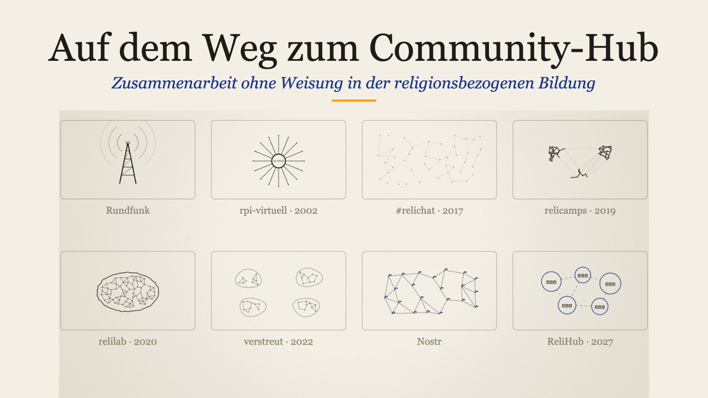
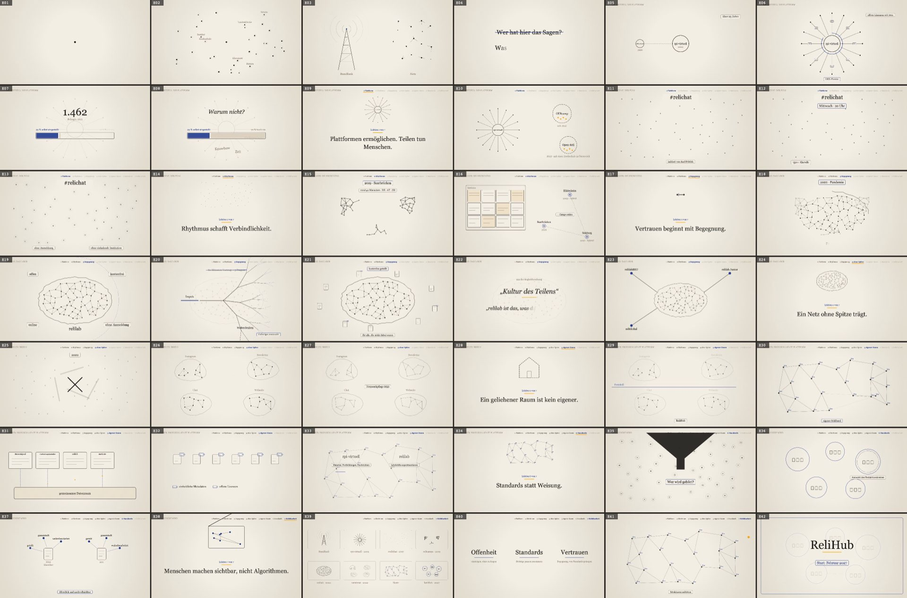

---
# commonMetadata
'@context': https://schema.org/
creativeWorkStatus: Published
name: 'Auf dem Weg zum Community-Hub: Zusammenarbeit ohne Weisung in der religionsbezogenen Bildung'
description: >-
  Wie arbeiten Menschen aus verschiedenen Institutionen zusammen, wenn niemand weisungsbefugt ist? Für das Panel „Zusammenarbeit für bessere Bildung(smaterialien)“ bei der CollaborAID hat Jörg Lohrer die Antwort als neunminütiges Video erzählt: von rpi-virtuell über den #relichat, die relicamps und das relilab bis zum ReliHub, in sieben Lektionen. Die Animationen sind vollständig als Programmcode entstanden, gebaut mit einem KI-Agenten. Video, Code und Making-of stehen unter CC BY 4.0.
license: https://creativecommons.org/licenses/by/4.0/deed.de
id: https://oer.community/auf-dem-weg-zum-community-hub
creator:
  - givenName: Jörg
    familyName: Lohrer
    id: https://orcid.org/0000-0002-9282-0406
    type: Person
    affiliation:
      name: Comenius-Institut
      id: https://ror.org/025e8aw85
      type: Organization
inLanguage:
  - de
image: auf-dem-weg-zum-community-hub.jpg
learningResourceType:
  - https://w3id.org/kim/hcrt/text
  - https://w3id.org/kim/hcrt/video
  - https://w3id.org/kim/hcrt/web_page
educationalLevel:
  - https://w3id.org/kim/educationalLevel/level_A
datePublished: '2026-11-23'
keywords:
  - Open Educational Practices (OEP)
  - Community
  - OER-Community
  - OERcamp
  - KI
  - Video
  - FOERBICO in Kontakt

# staticSiteGenerator
author:
  - Jörg Lohrer
title: 'Auf dem Weg zum Community-Hub: Zusammenarbeit ohne Weisung in der religionsbezogenen Bildung'
cover:
  relative: true
  image: auf-dem-weg-zum-community-hub.jpg
  alt: 'Vorschaubild des Videos „Auf dem Weg zum Community-Hub“: acht kleine Zeichnungen von Netzformen, vom Sendemast über Stern und Sternbild bis zum Netz'
  hiddenInSingle: true
summary: >-
  Wie arbeiten Menschen aus verschiedenen Institutionen zusammen, wenn niemand weisungsbefugt ist? Für das Panel „Zusammenarbeit für bessere Bildung(smaterialien)“ bei der CollaborAID hat Jörg Lohrer die Antwort als neunminütiges Video erzählt: von rpi-virtuell über den #relichat, die relicamps und das relilab bis zum ReliHub, in sieben Lektionen. Die Animationen sind vollständig als Programmcode entstanden, gebaut mit einem KI-Agenten. Video, Code und Making-of stehen unter CC BY 4.0.
url: auf-dem-weg-zum-community-hub
tags:
  - Open Educational Practices (OEP)
  - Community
  - OER-Community
  - OERcamp
  - KI
  - Video
  - FOERBICO in Kontakt
# bilder  (Konvention: bildattribution.md · Schlüssel = Dateiname oder Hash-URL)
# Lizenz nach Footer von oer.community: CC BY FOERBICO, soweit nicht anders angegeben.
bilder:
  auf-dem-weg-zum-community-hub.jpg:
    alt: 'Vorschaubild des Videos „Auf dem Weg zum Community-Hub“: acht kleine Zeichnungen von Netzformen, vom Sendemast über Stern und Sternbild bis zum Netz'
    title: Auf dem Weg zum Community-Hub – Zusammenarbeit ohne Weisung in der religionsbezogenen Bildung
    sourceUrl: https://vimeo.com/1245397913
    author: Jörg Lohrer / FOERBICO, Comenius-Institut
    authorUrl: https://oer.community/
    licence: CC BY 4.0
    licenceUrl: https://creativecommons.org/licenses/by/4.0/
    keywords: ['videovorschau', 'erklärvideo', 'netz', 'community', 'zeichnung', 'rpi-virtuell', 'relichat', 'relicamps', 'relilab', 'video thumbnail', 'network', 'drawing']
  kontaktbogen.jpg:
    alt: Kontaktbogen mit 42 kleinen Standbildern, eines je Sinneinheit des Videos, gezeichnet in Schwarz und Blau auf Papierton
    title: Kontaktbogen zum Video „Auf dem Weg zum Community-Hub“
    sourceUrl: https://git.rpi-virtuell.de/Comenius-Institut/FOERBICO_und_rpi-virtuell/src/branch/main/Events/workshops/2026-11-14-CollaborAID-Panel
    author: Jörg Lohrer / FOERBICO, Comenius-Institut
    authorUrl: https://oer.community/
    licence: CC BY 4.0
    licenceUrl: https://creativecommons.org/licenses/by/4.0/
    keywords: ['kontaktbogen', 'standbilder', 'making-of', 'animation', 'creative coding', 'contact sheet', 'stills']
---

*Impuls von Jörg Lohrer (FOERBICO, Comenius-Institut) im Panel „Zusammenarbeit für bessere Bildung(smaterialien): Was wir von Bildungsnetzwerken lernen können“, Partnertrack des [OERcamp](https://oercamp.de/) bei der CollaborAID, 14. November 2026, online.*

Im Panel, moderiert von Frank Homp, haben Anja Lorenz (Digital Learning Campus Schleswig-Holstein), Sandra Schön (L3T) und Jörg Lohrer aus dem FOERBICO-Team gezeigt, welche Modelle der Zusammenarbeit in verschiedenen Bildungsnetzwerken erprobt wurden. Die Frage lautete: Wie funktioniert Zusammenarbeit über Institutionsgrenzen hinweg, wenn niemand weisungsbefugt ist? Und welche Rolle spielen dabei Offenheit, gemeinsame Standards und Vertrauen?

Dazu gab Jörg mit einem Videoimpuls Einblicke in die Erkenntnisse, die am Comenius-Institut und gemeinsam mit zahlreichen Partnern in 25 Jahren Community-Arbeit gewonnen wurden.

[Auf dem Weg zum Community-Hub – Zusammenarbeit ohne Weisung in der religionsbezogenen Bildung](https://vimeo.com/1245397913), Jörg Lohrer / FOERBICO, Comenius-Institut, [CC BY 4.0](https://creativecommons.org/licenses/by/4.0/)

▶ [Video auf Vimeo ansehen](https://vimeo.com/1245397913) (9 Minuten, mit Untertiteln und Kapitelmarken)

## Eine Geschichte in sieben Lektionen

Das Video folgt einer Form, die sich verändert: der Form des Netzes, in dem Menschen in der religionsbezogenen Bildung miteinander verbunden sind. Jede Station endet mit einer Lektion.

- **rpi-virtuell (seit 2002):** Eine offene [Plattform](https://rpi-virtuell.de/), seit 2011 mit offenen Lizenzen. Die meisten kommen wegen des Materials, selbst etwas eingestellt haben nur wenige. *Plattformen ermöglichen. Teilen tun Menschen.*
- **#relichat (2017–2022):** Kein Ort, sondern ein [Termin](https://relichat.org/): jeden Mittwoch um 20 Uhr auf Twitter vor der Übernahme durch Elon Musk, ins Leben gerufen von Karl Peböck aus Österreich. *Rhythmus schafft Verbindlichkeit.*
- **relicamps (2019–2022):** Aus Begegnungen im Netz werden Begegnungen vor Ort, als [Barcamps](https://relicamp.de/) für religiöse Bildung. *Vertrauen beginnt mit Begegnung.*
- **relilab (seit 2020):** Ein [Netzwerk](https://relilab.org/) - offen, kostenfrei, online und ohne Anmeldung, über Bundesländer und Religionen hinweg. Wer mitmacht, gestaltet mit. *Ein Netz ohne Spitze trägt.*
- **Der Bruch:** Aus Twitter wurde X, der #relichat endete und die Community lebt nun auf vielen Inseln verteilt weiter. *Ein geliehener Raum ist kein eigener.*
- **Der Hub:** Statt einer neuen Plattform verbindet das offene Protokoll [Nostr](https://nostr.com/) die Orte, an denen Communities und Institute ohnehin arbeiten. *Standards statt Weisung.*
- **Wer gehört wird:** Was oben steht, ergibt sich aus dem, was Menschen mit einem Material tun, und diese Spuren sind öffentlich. *Menschen machen sichtbar, nicht Algorithmen.*

## Wie das Video entstanden ist

Die Machart ist so offen wie das Thema. Jede Animation im Video ist Programmcode, geschrieben im Wechsel mit dem KI-Agenten Claude Code. Es gibt keinen Bild- oder Videogenerator, die Bilder sind gezeichnete Grafik, und die Stimme ist die echte von Jörg Lohrer.

Kontaktbogen zum Video, Jörg Lohrer / FOERBICO, Comenius-Institut, [CC BY 4.0](https://creativecommons.org/licenses/by/4.0/)

Die Arbeit lief in wenigen Schritten:

1. **Sprechtext in Sinneinheiten.** Der Agent schrieb einen ersten Entwurf aus vorhandenen Texten, Interviews und Protokollen. Was nicht belegt war, blieb als Prüfmarke im Text, bis es geklärt war. Inhalt, Fakten und Entscheidungen lagen bei Jörg Lohrer.
2. **In einem Stück einsprechen.** Die Aufnahme wurde automatisch geschnitten: Eine lokal laufende Spracherkennung fand jede Sinneinheit in der Aufnahme, nahm bei Versprechern die letzte vollständige Fassung und setzte gleichmäßige Pausen.
3. **Animieren als Funktion der Zeit.** Jede Szene ist eine kleine Zeichenfunktion im Browser. Bewegungen hängen an gesprochenen Wörtern und passen deshalb auch nach einer Nachaufnahme ohne Nacharbeit.
4. **Prüfen und überarbeiten.** Ein Kontaktbogen mit einem Standbild je Einheit und eine Gegenprobe der fertigen Tonspur fanden Fehler früh. Nach einer Rückmelderunde im Team wurden einzelne Absätze nachgesprochen und automatisch eingesetzt.
5. **Veröffentlichen.** Aus der Zeitleiste entstehen Untertitel, Kapitelmarken und das Vorschaubild.

Video, Sprechtext, Code und Making-of stehen unter [CC BY 4.0](https://creativecommons.org/licenses/by/4.0/deed.de). Im Repository liegt eine Anleitung, mit der sich ein solches Video zu einem eigenen Thema nachbauen lässt, samt den Aufträgen an den KI-Agenten:

👉 [Making-of und Anleitung zum Nachmachen](https://git.rpi-virtuell.de/Comenius-Institut/FOERBICO_und_rpi-virtuell/src/branch/main/Events/workshops/2026-11-14-CollaborAID-Panel)

## Den ReliHub kennenlernen: FOERBICO-Abschlusstagung 2027

Der ReliHub geht im Februar 2027 an den Start. Vorgestellt wird er auf unserer Abschlusstagung **„Offen. Vernetzt. Zukunft – Open Education in (religionsbezogenen) Communities“** am 2. und 3. Februar 2027 an der Goethe-Universität Frankfurt. Die Tagung bringt OER-Communities und Akteur:innen aus Wissenschaft, Bildungspraxis, Kirche und Zivilgesellschaft zusammen.

📅 Anmeldung bis 22. Januar 2027 unter [tinygu.de/foerbico2027]](https://www.uni-frankfurt.de/de/fachbereich-7/professuren/mediendidaktik-und-religionspaedagogik/news/foerbico-abschlusstagung)
