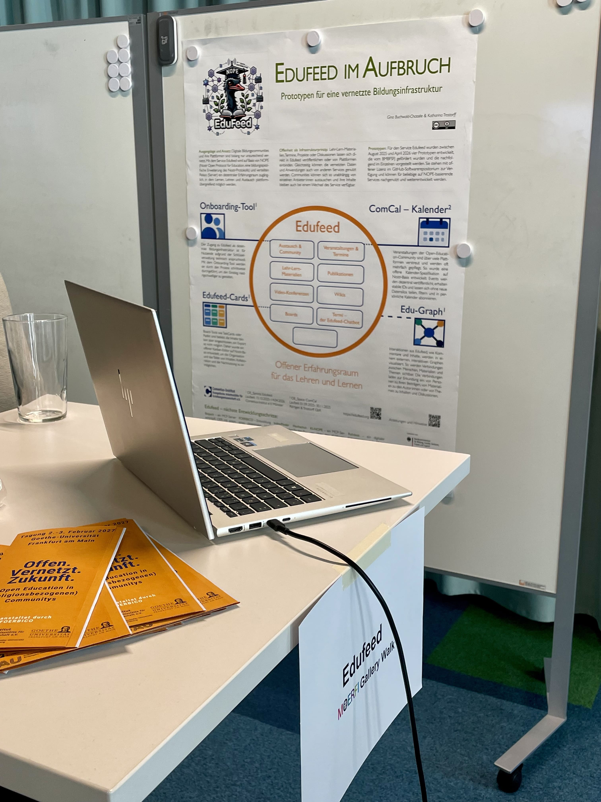
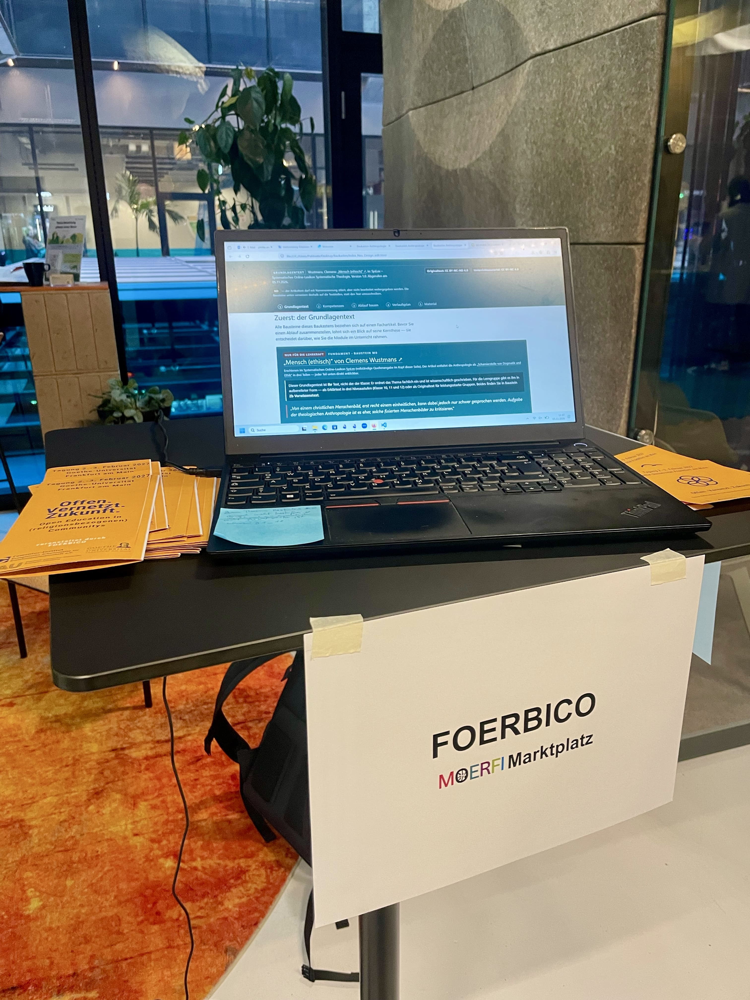
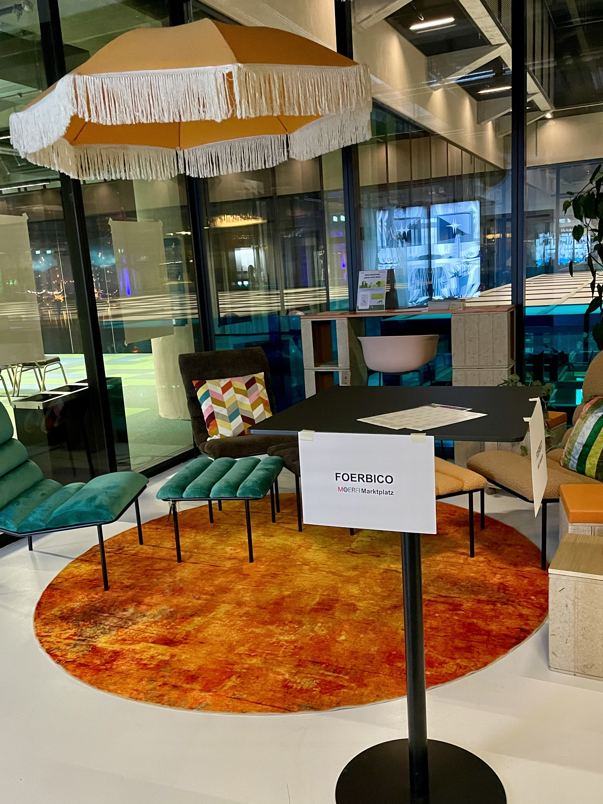
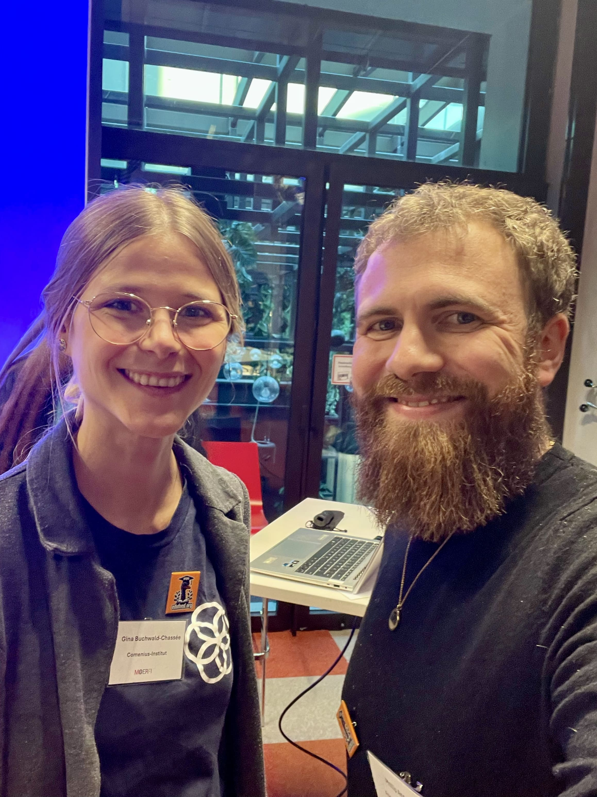

---
# commonMetadata
'@context': https://schema.org/
creativeWorkStatus: Published
name: 'MOERFI-Demotage in Berlin: Inspiration, Austausch und offene Bildungsnetzwerke'
description: >-
  Der 3. MOERFI-Demotag in Berlin brachte Menschen aus Bildung, Wissenschaft und digitalen Communities zusammen, um innovative Ansätze für offene Bildungsinfrastrukturen zu entdecken und weiterzudenken. Im Mittelpunkt standen Edufeed, dezentrale Bildungsnetzwerke, offene Technologien und die Frage, wie digitale Lernräume Vernetzung, Teilhabe und selbstbestimmtes Lernen fördern können. Einblicke, Austausch und praktische Erfahrungen zeigten, wie gemeinschaftliche digitale Bildung gestaltet werden kann.
license: https://creativecommons.org/licenses/by/4.0/deed.de
id: https://oer.community/moerfi-demotage-2026
creator:
  - givenName: Gina
    familyName: Buchwald-Chassée
    type: Person
    affiliation:
      name: Comenius-Institut
      id: https://ror.org/025e8aw85
      type: Organization
  - givenName: Phillip
    familyName: Angelina
    id: https://orcid.org/0000-0002-6905-5523
    type: Person
    affiliation:
      name: Friedrich-Alexander-Universität Erlangen-Nürnberg
      id: https://ror.org/00f7hpc57
      type: Organization
inLanguage:
  - de
about:
  - https://w3id.org/kim/hochschulfaechersystematik/n0
image: https://oer.community/moerfi-demotage-2026/IMG_3602.jpeg
learningResourceType:
  - https://w3id.org/kim/hcrt/text
  - https://w3id.org/kim/hcrt/web_page
educationalLevel:
  - https://w3id.org/kim/educationalLevel/level_A
datePublished: '2026-11-26'
keywords:
  - Nostr
  - Community
  - Open Educational Resources (OER)
  - Digitalisierung
  - FOERBICO in Kontakt
  - Event

# staticSiteGenerator
author:
  - Gina Buchwald-Chassée
  - Phillip Angelina
title: 'MOERFI-Demotage in Berlin: Inspiration, Austausch und offene Bildungsnetzwerke'
cover:
  relative: true
  image: IMG_3602.jpeg
  alt: 'Blick entlang einer leeren Fußgängerbrücke, deren Dach aus Stahllamellen ein Streifenmuster aus Licht und Schatten auf den Gehweg wirft, an den Seiten weiße Pfosten und Geländer'
  hiddenInSingle: true
summary: >-
  Der 3. MOERFI-Demotag in Berlin bot spannende Einblicke in offene Bildungsinfrastrukturen, dezentrale Bildungsnetzwerke und Edufeed. Im Mittelpunkt standen Vernetzung, Teilhabe und die gemeinsame Gestaltung digitaler Bildungsräume.
url: moerfi-demotage-2026
tags:
  - Nostr
  - Community
  - Open Educational Resources (OER)
  - Digitalisierung
  - FOERBICO in Kontakt
  - Event
# bilder  (Konvention: bildattribution.md · Schlüssel = Dateiname oder Hash-URL)
# Lizenz nach Footer von oer.community: CC BY FOERBICO, soweit nicht anders angegeben.
bilder:
  IMG_3602.jpeg:
    alt: 'Markstand vom FOERBICO-Projekt beim Markt der Möglichkeiten der MOERFI-Demotage 2026 im smartvillage Berlin'
    title: FOERBICO-Marktstand
    sourceUrl: https://oer.community/moerfi-demotage-2026
    author: FOERBICO
    authorUrl: https://oer.community/
    licence: CC BY 4.0
    licenceUrl: https://creativecommons.org/licenses/by/4.0/deed.de
    keywords: ['markstand', 'FOERBICO', 'Stehtisch', 'MOERFI', 'Demotage', 'smartvillage', 'Berlin']
  IMG_3603.jpeg:
    alt: 'Markstand vom FOERBICO-Projekt beim Markt der Möglichkeiten der MOERFI-Demotage 2026 im smartvillage Berlin'
    title: FOERBICO-Marktstand bei MOERFI-Demotagen 2026
    sourceUrl: https://oer.community/moerfi-demotage-2026
    author: FOERBICO
    authorUrl: https://oer.community/
    licence: CC BY 4.0
    licenceUrl: https://creativecommons.org/licenses/by/4.0/deed.de
    keywords: ['markstand', 'FOERBICO', 'Stehtisch', 'MOERFI', 'Demotage', 'smartvillage', 'Berlin']
  IMG_3605.jpeg:
    alt: 'Poster Edufeed im Aufbruch beim Gallery Walk der MOERFI-Demotage 2026 im smartvillage Berlin'
    title: Posterpräsentation Edufeed im Aufbruch beim Gallery Walk
    sourceUrl: https://oer.community/moerfi-demotage-2026
    author: FOERBICO
    authorUrl: https://oer.community/
    licence: CC BY 4.0
    licenceUrl: https://creativecommons.org/licenses/by/4.0/deed.de
    keywords: ['Gallery Walk', 'Edufeed', 'Poster', 'MOERFI', 'Demotage', 'smartvillage', 'Berlin']
  attatchment.nMQrNZ.jpg:
    alt: 'Markstand vom FOERBICO-Projekt beim Markt der Möglichkeiten der MOERFI-Demotage 2026 im smartvillage Berlin mit Vorstellung des Syslex-Baukastens als Online-Tool zur Unterrichtsplanung'
    title: Vorstellung OER-Baukasten beim Markt der Möglichkeiten
    sourceUrl: https://oer.community/moerfi-demotage-2026
    author: FOERBICO
    authorUrl: https://oer.community/
    licence: CC BY 4.0
    licenceUrl: https://creativecommons.org/licenses/by/4.0/deed.de
    keywords: ['markstand', 'FOERBICO', 'Stehtisch', 'MOERFI', 'Demotage', 'smartvillage', 'Berlin', 'OER-Baukasten', 'Unterrichtsplanung', 'Syslex']
  attatchment.SS2mrW.jpg:
    alt: 'Gina und Phillip vom FOERBICO-Team bei den MOERFI-Demotagen im smartvillage Berlin'
    title: Gina und Phillip vom FOERBICO-Team
    sourceUrl: https://oer.community/moerfi-demotage-2026
    author: FOERBICO
    authorUrl: https://oer.community/
    licence: CC BY 4.0
    licenceUrl: https://creativecommons.org/licenses/by/4.0/deed.de
    keywords: ['FOERBICO', 'Team', 'Vernetzung', 'MOERFI', 'Demotage', 'smartvillage', 'Berlin']
---

„Was inspiriert uns?“ Mit dieser Frage eröffnete Katja Stamm vom Bundesministerium für Bildung, Familie, Senioren, Frauen und Jugend (BMBFSFJ) den 3. MOERFI-Demotag im smartvillage Berlin. Eine Frage, die den Kern der Veranstaltung ziemlich gut trifft: Wie können wir Bildungsräume schaffen, die Lernende inspirieren, ihre Bedürfnisse ernst nehmen und zeitgemäßes Lernen ermöglichen?

Schon zum dritten Mal fanden die MOERFI-Demotage statt. MOERFI steht für Demo-Tage und **M**apping von (**OER**-**f**örderlichen) Bildungs**i**nfrastrukturen. Ziel der Demotage ist es, Ideen und erste Ansätze vorzustellen und gemeinsam weiterzudenken. Dabei ging es nicht nur um technische Möglichkeiten, sondern auch um die Frage, wie digitale Bildungsräume Selbstbestimmung, Teilhabe und gemeinschaftliches Lernen ermöglichen können. Welche Rolle spielen dabei offene Bildungsressourcen und vernetzte Communities?

Die gesamte Dokumentation der MOERFI-Demotage findet ihr [hier](https://www.oer-strategie.de/vernetzen/moerfi/).

## Pre-Conference: Wie bleiben offene Bildungsansätze nachhaltig wirksam?

In der Pre-Conference wurde die Frage gestellt, wie die erarbeiteten Ergebnisse nach fast drei Jahren Förderung nachhaltig bei den Menschen ankommen. In den Diskussionen wurden verschiedene Stolpersteine deutlich. Beispielsweise stehen strukturelle und institutionelle Eigenlogiken der Implementierung von OER im Weg.

In bestimmten Bildungsbereichen stellte sich eine formal-juristische Frage: Wer haftet bei inhaltlich fehlerhaften OER-Materialien? Diese Dimension hat in unserer Forschung bisher keine Rolle gespielt, da es im FOERBICO-Projekt meist um Urheberrechtsfragen geht. In der Diskussion wurde jedoch darauf hingewiesen, dass auch diese Frage einer gewissen Absicherungslogik folgt. Denn selbst mit inhaltlich korrektem oder qualitätsgeprüftem Material ist eine fachlich korrekte Lehre nicht garantiert.

Der Austausch in der Pre-Conference zeigte, dass OER (und auch OEP) einer anderen Logik folgen als klassische Bildung innerhalb unserer strukturierten Lernsettings. Die damit verbundenen Fragen reichen über einzelne Materialien hinaus und betreffen auch institutionelle Rahmenbedingungen und die nachhaltige Verankerung offener Bildungsansätze.

## Eröffnung: Was brauchen Lernende eigentlich?

Konrad Faber vom Virtuellen Campus Rheinland-Pfalz und Susanne Friz vom FWU, die gemeinsam das MOERFI-Projekt leiten, gestalteten zusammen mit Katja Stamm die Eröffnung der Veranstaltung. Im Anschluss folgte der Impulsvortrag von Isa Jahnke unter dem Titel „Digitale didaktische Designs: Lehren und Lernen in einer digitalen Welt gestalten – From Open Educational Access to Learning (and Learning Experience)“.

Sie stellte das [DDD-Modell](https://ddd.devweb.mwn.de/) vor und machte deutlich, dass neben den digitalen Möglichkeiten auch soziale Faktoren eine wichtige Rolle bei der Gestaltung von Lehr- und Lernprozessen spielen. Da asynchrone Zusammenarbeit in digitalen Räumen häufig zeitversetzt stattfindet, werden beispielsweise auch Interaktionen mit KI-Chatbots als Gegenüber erprobt. Dabei bleibt die kritische Frage, inwieweit die soziale Komponente von Bildung technisch ersetzt werden könnte. Zusätzlich wurde darüber diskutiert, ob Bildung in Zeiten von KI unter Rechtfertigungsdruck steht.

Besonders eindrücklich wurde dies im anschließenden Podiumsgespräch mit Jugendlichen von [Jugend hackt](https://jugendhackt.org/). Sie brachten eine klare Perspektive auf die digitale Bildungswelt ein - kritisch und ehrlich, aber zugleich konstruktiv und mit konkreten Ideen:

**Lernen muss individueller und lebensnaher werden:** Unterricht sollte interessant sein, an den Alltag anknüpfen und einen echten Mehrwert bieten. Wenn das nicht gelingt, gibt es für junge Menschen viele andere Dinge, mit denen sie ihre Zeit verbringen können.

**Vertrauen statt Kontrolle:** Schülerinnen und Schüler brauchen einen Vertrauensvorschuss. Eine umfassende Kontrolle funktioniert in einer digitalen Welt ohnehin nicht.

**KI gehört zur Lebensrealität junger Menschen:** Statt sie zu stigmatisieren oder zu ignorieren, sollten Kompetenzen im Umgang damit vermittelt werden. Dafür braucht es auch eine klare Orientierung und Regeln.

**Barrierefreiheit muss umfassender gedacht werden:** Neben körperlichen müssen auch kognitive und geistige Beeinträchtigungen stärker berücksichtigt werden. Förderschulen sollten Schutzräume für individuelle Unterstützung sein und nicht zur Ausgrenzung beitragen. Gleichzeitig werden die Möglichkeiten der Digitalisierung hier noch zu wenig genutzt.

**Mitgestaltung auf Augenhöhe:** Junge Menschen wünschen sich mehr individuelle Möglichkeiten und echte Beteiligung. Besonders viel gelernt haben sie in informellen Lernräumen wie bei Jugend hackt.

Die Diskussion machte deutlich, wie wichtig es ist, junge Menschen nicht nur als Zielgruppe von Bildungsangeboten zu betrachten, sondern ihre Erfahrungen und Perspektiven aktiv in deren Gestaltung einzubeziehen. Die Jugendlichen brachten eine ausgeprägte digitale Kompetenz mit und hinterfragten beispielsweise kritisch, was mit ihren Daten geschieht und wie digitale Angebote funktionieren. Diese Kompetenzen haben sie nach eigener Aussage vor allem in außerschulischen Lernkontexten erworben. Entsprechend plädierten sie dafür, solche informellen Lernräume stärker anzuerkennen und zu fördern. Darin zeigte sich auch ein Verständnis digitaler Souveränität: Junge Menschen möchten digitale Technologien nicht einfach nur nutzen, sondern sie verstehen, kritisch hinterfragen und selbstbestimmt mitgestalten können.

## Gallery Walk: Edufeed im Aufbruch

Beim Gallery Walk stand „Edufeed im Aufbruch“ im Mittelpunkt: Vorgestellt wurden Prototypen aus den Förderprogrammen OE_Sprints und OE_Space.

Die Idee hinter Edufeed: Digitale Bildungsangebote besser miteinander verbinden und einen offenen Raum für Lernen, Lehren und Zusammenarbeit schaffen. Denn bislang sind Bildungscommunities und Plattformen häufig fragmentiert. Materialien, Diskussionen, Projekte und Veranstaltungstermine verteilen sich auf unterschiedliche Orte und Systeme. Edufeed basiert auf NOPE (Nostr Open Protocol for Education) und ermöglicht eine dezentrale Infrastruktur für den plattformübergreifenden Austausch von Inhalten und Kommunikation, ohne an einen einzelnen Anbieter gebunden zu sein.

Zwischen August 2025 und April 2026 wurden dazu verschiedene Prototypen entwickelt:

**Onboarding-Tool** für einen niedrigschwelligen Einstieg in die dezentrale Infrastruktur und als Unterstützung bei der Einrichtung und Verwaltung vom Schlüsselpaar.

**Edufeed-Cards:** Ein offener, Nostr-basierter Kanban-Editor, mit dem Inhalte organisiert, geteilt und gemeinsam weiterentwickelt werden können. 

**ComCal:** Eine offene, Nostr-basierte Kalenderspezifikation. Veranstaltungen können dezentral veröffentlicht und in persönlichen Kalendern abonniert oder gefiltert werden.

**EduGraph:** Eine interaktive Visualisierung von Beziehungen und Interaktionen zwischen Personen, Materialien und Themen. So lassen sich beispielsweise Beiträge und Kommentare erkunden oder Verbindungen zwischen Autorinnen und Autoren, Materialien und Diskussionen sichtbar machen.

Die Prototypen sind offen lizenziert und können genutzt, angepasst und weiterentwickelt werden. Die entsprechenden Projekte sind auf [GitHub](https://github.com/edufeed-org ) zu finden.

Mehr dazu: [https://edufeed.org/](https://edufeed.org/) 

Weiterführende Informationen im [Pad](https://pad.edufeed.org/s/TS0LZ30MQW).

Zum [Poster](https://edufeed.org/naddr1qvzqqqr4hcpzqxxmdjh926ycqq2v7mgu5cszlsxtmwulykgm8yg3pge9vg2lqyeqqyw8wumn8ghj7ctdvgkhyetvv9ujuetyw4nx2ety9ehhyee0qy2hwumn8ghj7un9d3shjtnyv9kh2uewd9hj7qgswaehxw309ahx7um5wghx6mmd9uqqsemhd9hrjure0q505zjj)

Die vorgestellten Ansätze zeigen, dass offene Bildungsinfrastrukturen mehr sein können als eine technische Lösung für den Austausch von Materialien. Sie schaffen auch Voraussetzungen dafür, dass Menschen über Plattformgrenzen hinweg miteinander in Kontakt kommen, Wissen teilen und gemeinsam arbeiten können. Damit greifen sie eine zentrale Frage des Impulsvortrags von Isa Jahnke auf: Wie lassen sich digitale Lernumgebungen gestalten, die neben dem Zugang zu Inhalten auch soziale Interaktionen und gemeinschaftliche Lernprozesse ermöglichen?

## Markt der Möglichkeiten: Offene Ansätze zum Ausprobieren

Auch auf dem Markt der Möglichkeiten gab es einiges zu entdecken. FOERBICO stellte dabei ein interaktives, modulares Baukastensystem für die Unterrichtsplanung vor, entwickelt von Phillip Angelina (FAU Erlangen-Nürnberg) und Corinna Link (Comenius-Institut). Im Mittelpunkt steht dabei die Verbindung von fachlicher Grundlage, Lehrplanbezug und konkreter Unterrichtspraxis: Ausgehend von einem Artikel entstehen ein Verlaufsplan und passende Arbeitsblätter, die anschließend auf die eigene Lerngruppe angepasst werden können. Demnächst werden weitere Termine für alle Interessierten zum Ausprobieren im [relilab](https://relilab.org/termine/) angeboten - herzliche Einladung dabei zu sein!

## Hands-on Edufeed – Offene Bildungsnetzwerke ausprobieren, nutzen und mitgestalten

In der zweiten Runde hieß es dann: „Hands-on Edufeed – Offene Bildungsnetzwerke ausprobieren, nutzen und mitgestalten“. Gina Buchwald-Chassée (Comenius-Institut Münster, FOERBICO), Steffen Rörtgen (Entwickler und Metadatenarchitekt, Comenius-Institut, Edufeed, KI-NOPE und ComCal) sowie Katharina Trostorff (Leibniz-Institut für Wissensmedien, Index/Finder Hochschullehre und KI-NOPE) gaben Einblicke in die praktische Nutzung und Weiterentwicklung von Edufeed.

Die Edufeed-Web-App bündelt verschiedene Möglichkeiten: Materialien, Veranstaltungen und Artikel entdecken oder veröffentlichen, Communities mit Feeds, offenen und geschlossenen Kanälen, Chat und Videokonferenzen nutzen sowie gemeinsam auf Kanban-Boards und in Wikis arbeiten. Auch der Chatbot Termi gehört als Unterstützung dazu.

Wichtig dabei: Die Inhalte liegen nicht in der App selbst, sondern auf den Relays. Das Prinzip lautet: Einmal veröffentlichen, überall nutzen. Die Urheberinnen und Urheber behalten die Kontrolle über ihre Inhalte, während verschiedene Plattformen und Apps darauf zugreifen und dazu beitragen können. Edufeed versteht sich damit nicht als Ersatz für bestehende Plattformen, sondern als gemeinsame, offene Vernetzungsschicht.

An drei Thementischen konnten die Teilnehmenden verschiedene Funktionen ausprobieren:

**Onboarding:** Schlüsselpaare, Profile und Communities erstellen & entdecken. 

**Events und Kalender:** Veranstaltungen finden, filtern und veröffentlichen.

**MCP (Model Context Protocol):** Über einen KI-Assistenten auf offene Lernmaterialien nach Fach, Jahrgangsstufe, Materialtyp oder Lizenz zugreifen und Materialien mit AMB-Metadaten veröffentlichen lassen.

Die Präsentation zum Workshop gibt es [hier](https://pad.edufeed.org/VtV1WQEsTN-3HHRwiWN73Q).

## Fazit

Der 3. MOERFI-Demotag hat viele spannende Ansätze, konkrete Prototypen und neue Perspektiven zusammengebracht. Besonders wertvoll war der Austausch darüber, wie offene Bildungsinfrastrukturen gestaltet werden können, damit sie Vernetzung, Zusammenarbeit und gemeinsames Lernen tatsächlich unterstützen.

Die Diskussionen haben gezeigt: Offene Bildungsressourcen, dezentrale Infrastrukturen und lebendige Communities können wichtige Voraussetzungen für eine selbstbestimmte und gemeinschaftliche digitale Bildung schaffen. Entscheidend ist dabei, die Bedürfnisse der Lernenden in den Mittelpunkt zu stellen und ihnen nicht nur Zugang zu Bildungsangeboten, sondern auch Möglichkeiten zur aktiven Mitgestaltung zu eröffnen.

Wie sich offene Bildungspraktiken und OER-Ökosysteme nachhaltig stärken lassen und welche Rolle dabei Communitys und Vernetzung spielen, möchten wir auch bei der FOERBICO-Abschlusstagung „Offen. Vernetzt. Zukunft. – Open Education in (religionsbezogenen) Communitys“ weiterdiskutieren. Die Tagung findet **am 2. und 3. Februar 2027** an der Goethe-Universität Frankfurt statt. Wir freuen uns darauf, die beim MOERFI-Demotag begonnenen Gespräche dort fortzuführen und gemeinsam Perspektiven für die Zukunft offener Bildung zu entwickeln.

Weitere Informationen & **Anmeldung bis 22.01.2027** findet ihr [hier](https://www.uni-frankfurt.de/de/fachbereich-7/professuren/mediendidaktik-und-religionspaedagogik/news/foerbico-abschlusstagung).

Vielen Dank an alle Beteiligten für die inspirierenden Impulse, die offenen Diskussionen und den gemeinsamen Blick auf die nächsten Schritte!

